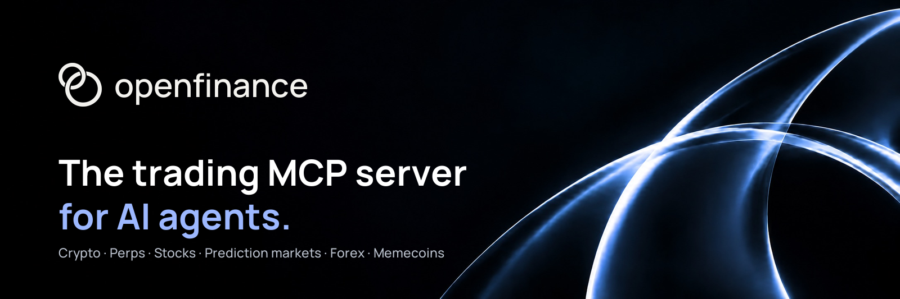
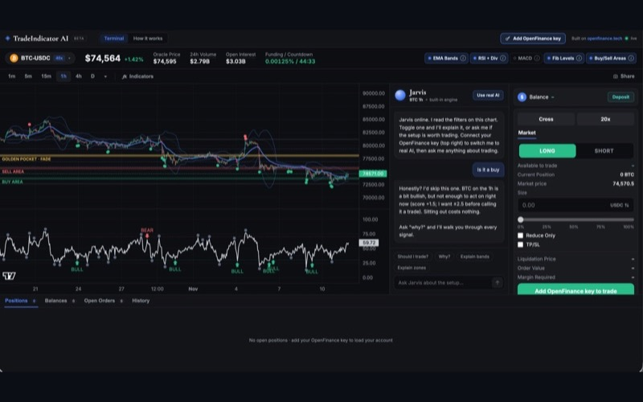
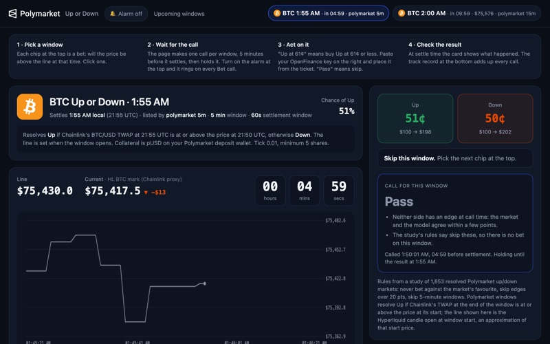
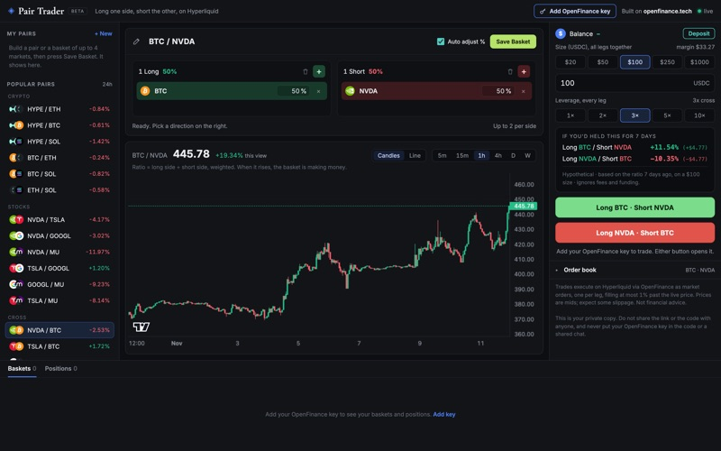
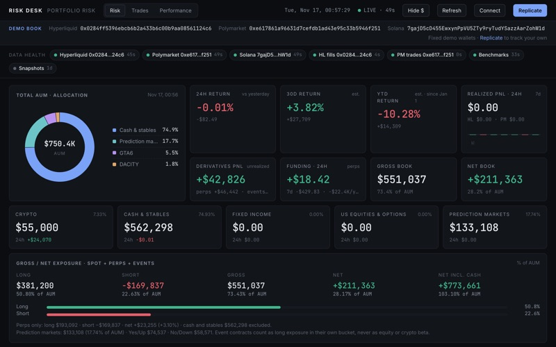

<p align="center">
  <a href="https://openfinance.tech/agents"></a>
</p>

<p align="center">
  <b>Let your AI agent trade.</b> One hosted MCP server for crypto spot and perps, stocks, forex, prediction markets and memecoins.<br />
  Nothing to install: add one URL to your AI client, sign in, and ask.
</p>

<p align="center">
  
  
  
  
  
  
  
</p>

### What your agent can trade

<table>
  <tr>
    <td align="center" width="33%"><br /><b>Hyperliquid</b><br /><sub>Crypto perps and spot, plus stock, forex and commodity perps</sub></td>
    <td align="center" width="33%"><br /><b>Polymarket</b><br /><sub>Prediction markets: sports, politics, crypto, world events</sub></td>
    <td align="center" width="33%"><br /><b>Onchain</b><br /><sub>Memecoins and swaps on Solana, Base and 40+ chains</sub></td>
  </tr>
</table>

### Connect in 60 seconds

```bash
claude mcp add --transport http openfinance-tech https://api.openfinance.tech/agent/mcp
```

```bash
npx skills add openfinance-tech/skills -y
```

<p><a href="https://cursor.com/en/install-mcp?name=openfinance-tech&config=eyJ1cmwiOiJodHRwczovL2FwaS5vcGVuZmluYW5jZS50ZWNoL2FnZW50L21jcCJ9"></a>&nbsp;<a href="https://insiders.vscode.dev/redirect/mcp/install?name=openfinance-tech&config=%7B%22type%22%3A%22http%22%2C%22url%22%3A%22https%3A%2F%2Fapi.openfinance.tech%2Fagent%2Fmcp%22%7D"></a></p>

Claude.ai, ChatGPT and other clients: add `https://api.openfinance.tech/agent/mcp` as a custom connector and sign in. [Setup for every client →](https://github.com/openfinance-tech/mcp#install-in-your-ai-client)

### What a trade looks like

> **You:** Using OpenFinance, go long BTC 5x with $50 on Hyperliquid and set a stop 4% below entry.
>
> **Agent:** Here's the order before I place it: **Long BTC perp on Hyperliquid**, 5x leverage, $50 margin ($250 position), market order, stop-loss 4% below the fill price. I'll show the fee and liquidation price from the live quote. Reply "confirm" to place it.

<sub>Example conversation. Your agent always shows a summary and waits for your go-ahead before any order.</sub>

### Built on OpenFinance

Apps from the [OpenFinance blueprint gallery](https://openfinance.tech/mainframe). Each one trades with your own OpenFinance key.

<table>
  <tr>
    <td width="50%"><a href="https://openfinance.tech/mainframe"></a><br /><b>AI assisted perps DEX</b><br /><sub>Your own Hyperliquid terminal with indicators and an AI copilot on your chart</sub></td>
    <td width="50%"><a href="https://openfinance.tech/mainframe"></a><br /><b>Polymarket Up/Down assist</b><br /><sub>One call per BTC and ETH up-or-down window, with an alarm and a track record</sub></td>
  </tr>
  <tr>
    <td width="50%"><a href="https://openfinance.tech/mainframe"></a><br /><b>Pair trader</b><br /><sub>Long one side, short the other, across up to 4 Hyperliquid markets</sub></td>
    <td width="50%"><a href="https://openfinance.tech/mainframe"></a><br /><b>Portfolio risk tool</b><br /><sub>One read-only screen for Hyperliquid, Polymarket, EVM and Solana wallets</sub></td>
  </tr>
</table>

### Repositories

| Repo | What it is |
|---|---|
| [**mcp**](https://github.com/openfinance-tech/mcp) | The OpenFinance MCP server: setup for every AI client, the tool reference, safety notes |
| [**polymarket-mcp**](https://github.com/openfinance-tech/polymarket-mcp) | How to research and trade Polymarket from Claude, ChatGPT, Grok, Cursor and others, with example configs |
| [**skills**](https://github.com/openfinance-tech/skills) | Agent skills for Polymarket, Hyperliquid, Relay, onchain tokens and launches: `npx skills add openfinance-tech/skills -y` |
| [**self-hosted-perp-dex**](https://github.com/openfinance-tech/self-hosted-perp-dex) | A Hyperliquid perp DEX with an AI agent that you deploy yourself, running on one OpenFinance key |

### What an agent can and can't do with your money

- Every order tool tells it to confirm with you first: it shows a summary and waits for your go-ahead, such as replying "confirm".
- It can move funds only between your own wallets. Sending to anyone else needs your sign-in on openfinance.tech and a code from your authenticator app.
- It can still trade, so a bad trade can lose money. Fund only what you're willing to risk.
- Your wallets are yours: export the private keys from Settings → Export Keys, with a code from your authenticator app.

<p align="center">
  <a href="https://openfinance.tech">openfinance.tech</a> · <a href="https://openfinance.tech/agents">Connect your agent</a> · <a href="https://docs.openfinance.tech">Docs</a> · <a href="https://openfinance.tech/security">Security</a> · <a href="https://x.com/openfinancelabs">X</a>
</p>

<p align="center"><sub>Trading carries a high risk of loss. Nothing here is financial advice.</sub></p>
